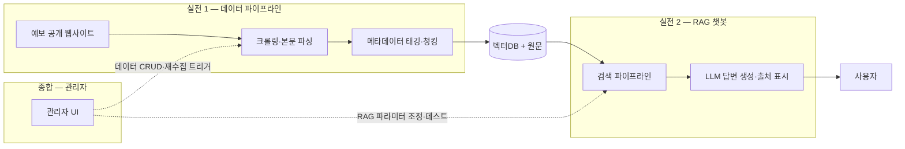

<div align="center">

# 4MATION

**LikeLion AI/NLP 5기 · 클라비 기업 연계 프로젝트**

예금보험공사(KDIC) 데이터 관리체계 고도화 및 생성형 AI 서비스 구축

</div>

---

> **저장소 상태 (2026-10-12 확인)** — 이 저장소는 2026-07-10 ~ 08-31의 **전체 이력판**이고 원격은
> [`likelion-4MATION/4MATION_archive`](https://github.com/likelion-4MATION/4MATION_archive)다.
> 2026-08-28 구동에 필요한 최소 파일만 뽑아 새 이력으로 재구성한 essential 저장소는
> [`likelion-4MATION/4MATION`](https://github.com/likelion-4MATION/4MATION)(첫 커밋 `b29eea7`)에 따로 있고,
> 08-28 이후 개발은 그쪽에서 했다. 두 저장소는 이력이 이어지지 않으므로 서로 병합하지 않는다.
> 이 저장소는 실험·평가·회의 기록과 은퇴 코드를 찾을 때 쓴다. 통합 브랜치는 `dev`다.

## 📌 프로젝트 소개

예금보험공사 공개 웹사이트(kdic.or.kr, fins.kdic.or.kr)에 산재한 데이터를 **중앙화**하고, 기존 Rule 기반 챗봇을 **RAG 기반 자연어 AI 챗봇**으로 개편하는 PoC 프로젝트.

- **문제**: 웹사이트 데이터가 산재해 있고, 기존 대외 챗봇은 Rule 기반이라 자연어 질의 대응 불가
- **목표**: 데이터 통합 관리 체계 + 6개 업무 질의에 답하는 RAG 챗봇 + 운영 모니터링 대시보드
- **성격**: 기술 타당성 검증(PoC) → 향후 사업화 기반 마련

## 🧩 프로젝트 구성 (3단계)

| 단계 | 이름 | 내용 | 상태 |
|------|------|------|------|
| 실전 1 | **데이터 파이프라인** | 크롤링 → 본문 파싱 → 메타데이터 태깅 → 청킹 → 벡터DB 적재 | ✅ v0 완료 — [`crawler/`](./crawler/) |
| 실전 2 | **RAG 챗봇** | 6개 업무 질의응답, 출처 표시, Qform, 절별 BF/OOS 처리 | ✅ PoC 통합 |
| 종합 | **관리자 기능** | 데이터 운영, RAG 파라미터, OOS 안내처, 오류 신고함 | ✅ PoC 통합 |

## 🏗 서비스 아키텍처



## 📦 기대 산출물

1. 6개 업무 검색 범위 정의서 + 수집 코퍼스 (계층 메타데이터 포함)
2. RAG 자연어 챗봇 (출처 표시·민원 처리 안내)
3. 관리자 트리거 기반 수집·전처리·적재 파이프라인
4. RAG 파라미터 테스트 관리자 UI
5. 평가 테스트셋 + 성능 평가 리포트

## 👥 팀원

| 이름 | 역할 | GitHub |
|------|------|--------|
| 김경은 | 팀장 / TBD | [@Gyeong-Eun](https://github.com/Gyeong-Eun) |
| 박유상 | TBD | [@us788](https://github.com/us788) |
| 양현욱 | TBD | [@ukkhnn](https://github.com/ukkhnn) |
| 문규남 | TBD | [@mungn0603-code](https://github.com/mungn0603-code) |

## 🛠 기술 스택

| 분류 | 현재 PoC | 비고 |
|------|------|------|
| Language | Python 3.11+ | — |
| 수집/전처리 | requests · BeautifulSoup(lxml) — 규칙 기반, LLM 미사용 | Playwright (동적 페이지 필요 시) |
| 임베딩 | `dragonkue/BGE-m3-ko` (로컬, 1024d) | 최초 실행 시 HF 캐시 다운로드 |
| 검색 | FAISS + BM25(kiwipiepy) + RRF + 6-BF soft boost | `crawler/rag.py` 정본 |
| LLM | HCX-003 / DeepSeek V4 Flash 실험 분기 | P0에서 DeepSeek 우세 신호, 운영 기본값 미변경 |
| UI | 정적 HTML/CSS/JS 챗봇 + HTML/JS 관리자 | 빌드 도구 없는 로컬 PoC |
| Backend | FastAPI 사용자 API + FastAPI/SQLite 관리자 | 기존 Q-Form·RAG 재사용 |
| Infra / 협업 | GitHub, Notion, Discord | — |

### 답변 생성 모델 비교 상태

2026-08-26 P0 파일럿(40문항, 같은 검색 컨텍스트, 모델당 3회 생성)에서 DeepSeek V4 Flash가
HCX-003보다 우세한 신호를 보였다. Solar Pro 4 블라인드 심사 F1 기준 DeepSeek 16승,
HCX 2승, 동률 22건이며 F2도 같은 총계였다. 할루시네이션 판정과 지연시간도 DeepSeek 쪽이
우세했다.

이 결과는 **실험 브랜치의 P0 방향성**이며 운영 기본값 변경 결정이 아니다. 최종 판단은 P0와
겹치지 않는 P1 150문항에서 재검증한다. 수치·한계·심사 감사 기록은
[`docs/records/HCX_DeepSeek_P0_결과_20260826.md`](./docs/records/HCX_DeepSeek_P0_결과_20260826.md),
실행 절차는 [`docs/current/OPENCODE_LLM_JUDGE.md`](./docs/current/OPENCODE_LLM_JUDGE.md)를 본다.

## 📂 프로젝트 구조

```text
4MATION/
├── crawler/        # 실전 1: 데이터 파이프라인 (수집→파싱→청킹→인덱스→평가)
│   ├── README.md   #   실행 순서·산출물 안내
│   ├── HOLES.md    #   이슈 원장 (판단 로그는 루트 DECISIONS.md)
│   └── data/       #   chunks.jsonl · 인덱스 · 평가 리포트
├── web/            # FastAPI 사용자 API · 정적 HTML/CSS/JS 챗봇 UI
├── chatbot/        # Qform · 절별 BF/OOS 오케스트레이션 · 레거시 Streamlit UI
├── admin/          # FastAPI 관리자 콘솔 · OOS 안내처 · 오류 신고 저장소
├── docs/           # 문서 — 성격별 4계층 + 인덱스 2종
│   ├── README.md            #   문서 지도
│   ├── 프로젝트_전체흐름.md   #   전체 그림 · 용어·지표 해설 (여기서 시작)
│   ├── INDEX_시간축.md       #   언제 무슨 일이 있었나
│   ├── INDEX_사건축.md       #   무슨 문제를 어떻게 풀었나
│   ├── current/    #   정본 — 지금 이대로 돌아간다
│   ├── records/    #   기록 — 측정·회의록·인계·7월 진행도
│   ├── plans/      #   계획 — 실행 여부를 배지에 명시
│   └── superseded/ #   폐기·경위
├── archive/        # 은퇴한 평가·라벨링 코드 · 손으로 떠 둔 옛 사본(bak/)
├── logs/           # 데일리 스탠드업
├── DECISIONS.md    # 판단 로그 (D0~D13)
└── CONTRIBUTING.md # 협업 규칙
```

## 🚀 실행 방법

현재 통합 버전의 설치·데이터 빌드·관리자·챗봇·테스트 명령은
[`docs/current/RUNBOOK.md`](./docs/current/RUNBOOK.md)를 정본으로 사용합니다. 이미 인덱스와 `.env`가 준비된
개발 환경에서는 다음 두 프로세스를 실행합니다.

```bash
# 터미널 1
source .venv/bin/activate      # PowerShell: .venv\Scripts\Activate.ps1
cd admin && python -m uvicorn main:app --host 127.0.0.1 --port 8600

# 터미널 2 — 리포지토리 루트
source .venv/bin/activate      # PowerShell: .venv\Scripts\Activate.ps1
python -m uvicorn web.main:app --host 127.0.0.1 --port 8501
```

새 로컬의 전체 설치는 [`SETUP.md`](./SETUP.md), OOS 운영 절차는
[`docs/current/OOS_구현_운영가이드.md`](./docs/current/OOS_구현_운영가이드.md)를 참고합니다.

## 📖 문서 읽는 순서

처음 보는 사람은 [`docs/프로젝트_전체흐름.md`](./docs/프로젝트_전체흐름.md) 하나로
전체를 잡을 수 있습니다 — 무엇을 만들었고, 무슨 문제를 어떻게 풀었고, 나오는 숫자가
무슨 뜻인지까지 담았습니다(**용어·지표 해설 포함, 사전 지식 불필요**).

| 알고 싶은 것 | 볼 곳 |
|---|---|
| 전체 그림 · 용어 해설 | [`docs/프로젝트_전체흐름.md`](./docs/프로젝트_전체흐름.md) |
| 어디에 무슨 문서가 있나 | [`docs/README.md`](./docs/README.md) |
| 날짜순 진행 경과 | [`docs/INDEX_시간축.md`](./docs/INDEX_시간축.md) |
| 사건별 문제 → 해결 | [`docs/INDEX_사건축.md`](./docs/INDEX_사건축.md) |
| 실행 명령 | [`docs/current/RUNBOOK.md`](./docs/current/RUNBOOK.md) |
| 코드가 왜 이 모양인가 | [`DECISIONS.md`](./DECISIONS.md) |

**문서 맨 위 배지를 먼저 보세요.** `정본`(current) · `기록`(records) ·
`계획`(plans — 현행과 다를 수 있음) · `폐기·경위`(superseded) 넷을 구분합니다.

## 🤝 협업 규칙

브랜치 전략, 커밋 컨벤션, PR 규칙은 [CONTRIBUTING.md](./CONTRIBUTING.md) 참고.

## 📅 프로젝트 기간

`2026.07.10 ~ 2026.09.02`
